<picture>
  <source media="(prefers-color-scheme: dark)" srcset="./assets/banner-dark.svg">
  
</picture>

 

  

Willkommen beim **Institut für Smarte Entwicklung und Maschinenelemente (ISEM)** der Technischen Universität Hamburg. 
Hier veröffentlichen wir Open-Source-Projekte aus Forschung, Lehre und studentischen Abschlussarbeiten – 
von Maschinenelementen über Methoden der Produktentwicklung bis zur Software.

---

## Software-Projekte

### Billard-Demonstrator „Billard@ISEM“

Ein Billard-Roboter aus einzelnen, vernetzten Modulen: Die Kamera erkennt die Kugeln, das Spielmodul steuert den Ablauf, der Beamer projiziert direkt auf den Tisch.

<table>
  <tr>
    <td width="50%" valign="top">
      <a href="https://github.com/ISEM-TUHH/billard-game-module"><b>billard-game-module</b></a> 
      Spielmodul: Ablaufsteuerung (Scheduling) und Kommunikation zwischen den Modulen, inklusive Weboberfläche für die Spielmodi.  
      
      
    </td>
    <td width="50%" valign="top">
      <a href="https://github.com/ISEM-TUHH/billard-camera-module"><b>billard-camera-module</b></a> 
      Computer-Vision-System für 8-Ball-Pool mit Raspberry Pi 5, HQ Camera und eigens trainierten YOLO-Modellen zur Detektion und Klassifikation.  
      
      
    </td>
  </tr>
  <tr>
    <td width="50%" valign="top">
      <a href="https://github.com/ISEM-TUHH/billard-beamer-module"><b>billard-beamer-module</b></a> 
      Beamer über dem Tisch: projiziert Bilder perspektivisch entzerrt auf die Spielfläche und gibt optional Ton aus.  
      
      
    </td>
    <td width="50%" valign="top">
      <a href="https://github.com/ISEM-TUHH/billard_base_module"><b>billard_base_module</b></a> 
      Gemeinsame Basisklasse der Module: API-Grundgerüst, Laden von Konfiguration und Secrets sowie Download-Seite für gespeicherte Dateien.  
      
      
    </td>
  </tr>
</table>

### Vorlagen für Abschlussarbeiten & Promotion

<table>
  <tr>
    <td width="100%" valign="top">
      <a href="https://github.com/ISEM-TUHH/dissertationsvorlage"><b>dissertationsvorlage</b></a> 
      Satzvorlage der Reihe „Forschungsberichte des ISEM“: Dissertation nach TUHH-Formalia setzen, als Buch drucken lassen und online bereitstellen – aus einer Quelle entstehen Druck-, Online- und Archivfassung.  
      
      
    </td>
  </tr>
</table>

### Methoden & Werkzeuge

<table>
  <tr>
    <td width="50%" valign="top">
      <a href="https://github.com/ISEM-TUHH/spalten"><b>spalten</b></a> 
      SPALTEN-Problemlösung (Albers et al.) als Claude-Code-Skill: sieben Module von der Situationsanalyse bis zum Lernen, mit Informationscheck zwischen den Modulen und Gates, an denen ein Mensch entscheidet.  
      
      
    </td>
    <td width="50%" valign="top">
      <a href="https://github.com/ISEM-TUHH/SheetGen"><b>SheetGen</b></a> 
      Pipeline zur Erzeugung synthetischer 2D-Blechteilgeometrien als skalierbare Trainingsdaten für ML-gestütztes Stanzen und Umformen.  
      
      
    </td>
  </tr>
</table>

<b>Archiv</b>

 
<table>
  <tr>
    <td width="100%" valign="top">
      <a href="https://github.com/ISEM-TUHH/Miro-API"><b>Miro-API</b></a> 
      Experimentierumgebung für die Miro API (archiviert, wird nicht mehr gepflegt).  
      
      
    </td>
  </tr>
</table>

---

## Mitmachen & Abschlussarbeiten

Viele der Projekte hier sind in studentischen Arbeiten entstanden – das Kameramodul des Billard-Demonstrators zum Beispiel im Rahmen einer Bachelorarbeit. Offene Themen für Bachelor- und Masterarbeiten sowie Stellen am Institut gibt es auf **[isem-karriere.de](https://isem-karriere.de)**.

Fehler gefunden oder eine Idee? Issues und Pull Requests in den jeweiligen Repositories sind willkommen.

---

Institut für Smarte Entwicklung und Maschinenelemente · Technische Universität Hamburg 
<a href="https://www.tuhh.de/isem/willkommen">Webseite</a> · <a href="https://isem-karriere.de">Karriere</a> · Dieses Profil wird im Repository <a href="https://github.com/ISEM-TUHH/.github">.github</a> gepflegt.

